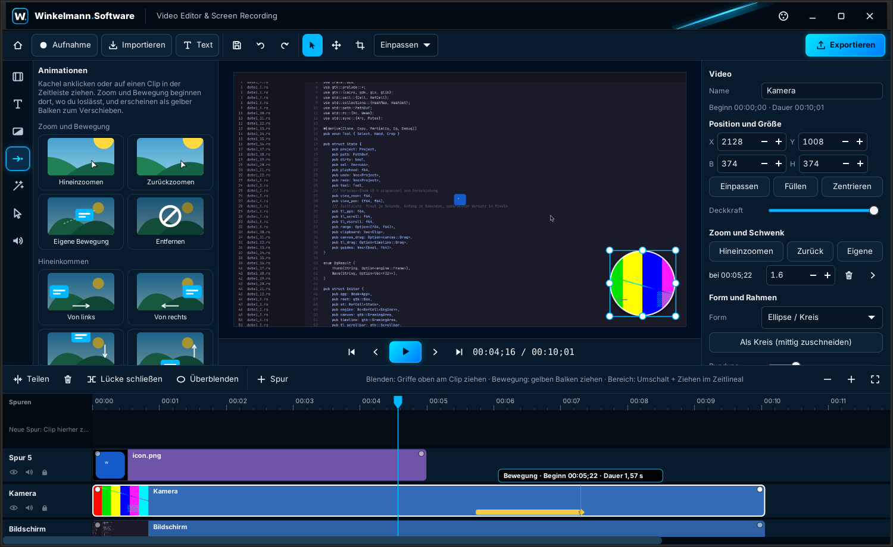

<p align="center"></p>

# WS.Video

Kostenloser, quelloffener Bildschirmrekorder und Videoeditor für Linux mit Wayland, von [Winkelmann.Software](https://winkelmann.software).
Bildschirm, Kamera, Mikrofon und Systemton werden getrennt aufgenommen und landen direkt im Editor:
Schnitt, Übergänge, Animationen, Zoom auf den Mauszeiger, Klick-Ringe, Tonverbesserung per Klick und
Export bis 4K (H.264, HEVC, AV1, auch auf der Grafikkarte).

**Download:** [Releases](../../releases/latest) · **Installationsanleitung:** [ANLEITUNG.md](ANLEITUNG.md) · **Webseite und Service:** [winkelmann.software](https://winkelmann.software)



## Installieren

**AppImage** (Ubuntu ab 24.04, Linux Mint 22, Debian 13, Fedora ab 43, Rocky Linux 10, Arch):
`WS.Video-0.9.0-x86_64.AppImage` aus den [Releases](../../releases/latest) laden, ausführbar machen, starten.

```bash
chmod +x WS.Video-0.9.0-x86_64.AppImage
./WS.Video-0.9.0-x86_64.AppImage
```

**Arch / Omarchy** klassisch: `ws-video-0.9.0.tar.gz` entpacken und `./install.sh` ausführen. Aus diesem
Repository heraus baut `./install.sh` das Programm aus dem Quelltext (Rust, braucht `cargo`).
Das AppImage baut `quelltext/paket/appimage/bauen.py`.

Schritt für Schritt für jedes System: [ANLEITUNG.md](ANLEITUNG.md). Alle Funktionen und Änderungen: [LIESMICH.md](LIESMICH.md).

## Aufbau

| Ordner | Inhalt |
| --- | --- |
| `quelltext/` | Rust-Quelltext (GTK 4, GStreamer, GStreamer Editing Services) |
| `themen/` | Beispiel für ein eigenes Design |
| `vorlagen/` | Bildvorlagen |
| `bilder/` | Bildschirmfotos |
| `install.sh`, `uninstall.sh` | Installieren und Entfernen |

## Fehler melden

`ws-video --fehlerbericht` ausführen und die Datei `~/Downloads/ws-video-fehlerbericht.txt` an ein
[Issue](../../issues) anhängen.

## Lizenz

GNU General Public License Version 3 oder später, siehe [LIZENZ.txt](LIZENZ.txt) und [LICENSE](LICENSE).
Die Namen „WS.Video“ und „Winkelmann.Software“ sowie das Logo sind davon ausgenommen.
